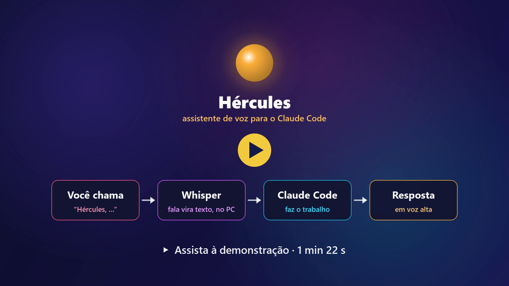
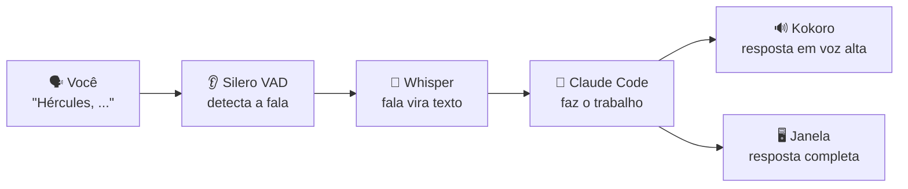

<div align="center">


**Você fala, o Claude Code trabalha no seu PC e responde em voz alta.**


<br />


<br /><br />

<a href="https://github.com/FelipeMendes-git/hercules/blob/main/docs/midia/hercules-demonstracao.mp4">
  
</a>

<sub>Clique na imagem para ver o vídeo de demonstração (1 min 22 s).</sub>

</div>

---

## ✨ O que ele faz

Chame **"Hércules"** e peça o que quiser, falando normalmente. O pedido vai para o **Claude Code**, que faz o
trabalho de verdade no seu computador: lê e edita arquivos, roda comandos, mexe em projetos, consulta sua
agenda e responde perguntas. A resposta aparece na janela e é lida em voz alta, em português do Brasil.

<table>
  <tr>
    <td width="33%" valign="top">
      <h3>🎙️ Só pela voz</h3>
      Chame pelo nome e fale. Pode parar para pensar: ele espera você terminar, ou mande na hora dizendo <b>"câmbio"</b>.
    </td>
    <td width="33%" valign="top">
      <h3>🧠 Claude Code de verdade</h3>
      Não é um chatbot: é o mesmo Claude Code do terminal, com acesso aos seus projetos e pedindo permissão por voz quando é arriscado.
    </td>
    <td width="33%" valign="top">
      <h3>🔒 Voz 100% local</h3>
      Detecção de fala, reconhecimento (Whisper) e voz sintética (Kokoro) rodam no seu PC. Só o pedido vai para o Claude.
    </td>
  </tr>
  <tr>
    <td valign="top">
      <h3>🫧 Bolinha flutuante</h3>
      Uma bolha colorida que ondula com o som e muda de cor conforme o estado: ouvindo, pensando, trabalhando, falando.
    </td>
    <td valign="top">
      <h3>💤 Quase não pesa</h3>
      Em espera usa ~0,2 GB de RAM e ~0% de processador. Acorda em 2 a 3 segundos quando você chama.
    </td>
    <td valign="top">
      <h3>🎸 Personalidade</h3>
      Saudações sorteadas com uma vinheta de rock composta pelo próprio app, e "jabuticabal" para mandá-lo dormir.
    </td>
  </tr>
</table>

## ⚙️ Como funciona



1. **Espera leve:** um modelo pequeno (Whisper tiny, no processador) fica só procurando o nome.
2. **Acorda:** ao ouvir "Hércules", carrega o reconhecimento preciso (Whisper large-v3-turbo, na placa de vídeo).
3. **Entende:** quando você para de falar (ou diz "câmbio"), o pedido vira texto e vai para o Claude Code pelo **Claude Agent SDK**.
4. **Trabalha:** o Claude Code usa as ferramentas dele no projeto escolhido e também controla o próprio app (trocar de projeto, abrir arquivos, ver a tela, desfazer).
5. **Responde:** a resposta completa aparece na janela e um resumo curto é falado pela voz do Kokoro.

## 🚀 Começando

**Requisitos:** Windows 10 ou 11, Python 3.12, uma conta do Claude (Pro ou Max) e, de preferência, placa de vídeo NVIDIA.

```powershell
# 1. Instale o Claude Code e faça login com a sua conta do Claude
irm https://claude.ai/install.ps1 | iex
claude auth login --claudeai

# 2. Baixe o Hércules e instale
git clone https://github.com/FelipeMendes-git/hercules.git
cd hercules
powershell -ExecutionPolicy Bypass -File scripts\instalar.ps1

# 3. Abra
scripts\iniciar.bat
```

Na primeira vez, o app baixa os modelos de voz (~340 MB) e de reconhecimento (~1,6 GB).

## 💬 Exemplos do que dá para pedir

| Você diz | O que acontece |
|---|---|
| "Hércules, muda o título do meu site para branco." | O Claude edita o código e avisa quando terminou |
| "Hércules, marca uma reunião amanhã às 15h." | Cria o evento na sua agenda |
| "Hércules, vai pro projeto do portfólio e me diz o que falta." | Troca de projeto e analisa o código |
| "Hércules, olha a minha tela. Que erro é esse?" | Tira um print e explica o que está vendo |
| "Hércules, desfaz o que você fez." | Volta as alterações do último pedido |
| "Jabuticabal." | Para tudo na hora e volta a cochilar |

## 🛠️ Feito com

- **[Claude Agent SDK](https://docs.claude.com/en/docs/agent-sdk/overview)**: a ponte com o Claude Code, sessões e permissões
- **[faster-whisper](https://github.com/SYSTRAN/faster-whisper)**: reconhecimento de fala na placa de vídeo
- **[Kokoro](https://github.com/thewh1teagle/kokoro-onnx)**: voz sintética em português do Brasil
- **[Silero VAD](https://github.com/snakers4/silero-vad)**: detecção de voz
- **[PySide6](https://doc.qt.io/qtforpython-6/)**: janela, bolinha animada e bandeja

---

# 📖 Guia completo

## Antes de usar: login no Claude Code

O app usa o Claude Code instalado no PC, com a **sua conta do Claude** (a mesma assinatura do
Claude Desktop). Faça login uma vez:

```powershell
claude auth login --claudeai
```

`--claudeai` garante o login pela assinatura. Não use `--console`: ele cobra por uso de API. O app
não usa chave de API. Se faltar o login, a janela mostra um cartão com o botão **Fazer login**.

## Abrir o app

- Clique duas vezes em `scripts\iniciar.bat`, ou
- rode `scripts\criar_atalho.ps1` uma vez para ter um atalho na Área de Trabalho, ou
- pelo terminal: `.venv\Scripts\hercules.exe` (janela) ou
  `.venv\Scripts\hercules-console.exe` (sem janela, mostrando tudo no terminal).

Na primeira vez, o app baixa os modelos que faltarem (voz ~340 MB, reconhecimento ~1,6 GB).

### A bolinha

Com a janela fechada ou minimizada, o Hércules vira uma bolinha flutuante: uma bolha colorida que
ondula com o som (a voz dele e a sua, no microfone) e muda de cor e de movimento conforme o estado.

| Bolha | Estado |
|---|---|
| Lilás e apagadinha, respirando devagar | cochilando (em espera, gastando quase nada): só procura o nome, e continua lilás mesmo com gente falando perto |
| Verde-água | acordado: pode falar, sem o nome |
| Rosa, ondulando com a sua voz | ouvindo você (só acordado, depois que você chamou "Hércules") |
| Magenta, pulsando de leve | pedido esperando: continue falando, ou diga "câmbio" para mandar já |
| Azul, com um brilho girando | o Claude está pensando |
| Ciano, girando em três pedaços | o Claude está trabalhando (editando arquivos, rodando comandos...) |
| Âmbar, ondulando com a voz | falando |
| Laranja, piscando | esperando a sua permissão |
| Vermelha, tremendo | erro |

- **Clique:** abre a janela com as conversas e as configurações. **Arraste:** muda o lugar (o app
  lembra). **Passe o mouse:** mostra o estado, o que o Claude está fazendo, o modelo e o esforço.
- **Botão direito → Sempre em primeiro plano:** ligado, a bolinha fica por cima de todas as janelas;
  desligado, vira uma janela comum, com botão na barra de tarefas, que pode ficar atrás das outras.
  A escolha fica salva (também em **⚙ → Janela**).
- No topo da janela principal ficam a mesma bolha, o estado, o modelo e o esforço que o Claude está
  usando (padrão: **Opus 5.5, esforço médio**) e o modo de permissões.

### A janela

A janela de conversa tem o visual **vidro claro**: painéis de vidro branco translúcido, cantos bem
arredondados e um **fundo vivo**, com manchas de cor suaves que flutuam devagar e mudam de cor junto com a
bolha (âmbar falando, azul pensando, ciano trabalhando...). O fundo custa pouco: ~3% de um núcleo com a
janela em foco, menos com ela atrás de outras e nada quando ela está fechada (só a bolinha).

### Iniciar com o Windows

Em **⚙ → Janela**, marque **Iniciar junto com o Windows**. O app passa a abrir escondido na bandeja
(perto do relógio), já ouvindo. A opção fica em "Aplicativos de inicialização" do Gerenciador de
Tarefas, onde também dá para desligar. Se o microfone não estiver pronto quando o Windows abrir (ou
o headset desligar no meio do caminho), o app tenta reconectar sozinho a cada 10 segundos.

## Quanto o app pesa no PC

O app abre **em espera**: só a detecção de voz e um modelo leve (Whisper tiny, no processador) ficam
carregados, procurando o nome no que o microfone ouve. Quando você chama, ele acorda: o
reconhecimento preciso (placa de vídeo), a voz e o Claude Code carregam em paralelo, uns 2 a 3
segundos a mais nessa vez. Depois de 10 minutos sem ser chamado, ele volta para a espera (a conversa
continua salva e é retomada na próxima vez).

Medido neste PC (Ryzen 7 9800X3D, RTX 5070), com `scripts\medir_consumo.py`:

| Momento | RAM em uso | Memória de vídeo | Processador |
|---|---|---|---|
| Ao abrir (em espera) | ~0,2 GB | 0 | ~0% (detecção de voz: 0,18% de um núcleo) |
| Alguém fala perto sem chamar o nome | igual | 0 (não usa a placa) | ~0,15 s de dois núcleos por frase |
| Acordado (depois de chamar) | ~1,2 GB + ~0,2 GB do Claude Code | ~1,25 GB | ~0,15 s de placa de vídeo por frase |
| De volta à espera | ~0,1 GB | ~0,17 GB* | ~0% |

\* Depois da primeira chamada, o driver da NVIDIA mantém ~0,17 GB até o app fechar. O app também
guarda ~1,3 GB de memória reservada que fica no disco, sem ocupar RAM física.

O app roda com prioridade "abaixo do normal": numa disputa por processador (um jogo, por exemplo), o
outro programa ganha. Tudo isso fica em **⚙ → Desempenho**.

## Como falar com ele

- **Chame pelo nome para acordar e peça:** "Hércules, explica o que esse projeto faz."
- **Pode parar para pensar:** o pedido só vai para o Claude depois de **5 segundos de silêncio**. O que
  você falar antes disso entra no mesmo pedido, sem repetir o nome. Enquanto isso, a bolinha fica
  magenta e a janela mostra o pedido com a contagem e os botões **Mandar agora** e **Descartar**.
- **"Câmbio" manda na hora:** termine com "câmbio", como no rádio: "Hércules, cria um script de
  backup, câmbio". A palavra só vale no fim e sai do pedido. Depois de "o", "do", "no"... ela é o
  substantivo ("como está o câmbio?") e não manda nada.
- **"Cancela"** (ou "esquece", "deixa pra lá"), sozinho, joga fora o pedido que ainda não foi. Sem
  rascunho aberto, esvazia a fila.
- **Completar logo depois:** se você completar o pedido até 10 segundos depois de mandar, e o Claude
  ainda não tiver mexido em nada (só ler arquivos não conta), ele é interrompido e recebe o pedido
  inteiro de novo, junto. Nesse tempo, nem precisa dizer o nome.
- **Fila:** depois disso, um pedido novo (com o nome) vai para a fila e é mandado quando o Claude
  terminar; a janela mostra a fila e dá para tirar um item no **✕**. Um pedido novo falado por cima
  de uma resposta faz o Hércules parar de falar na hora.
- Os três tempos e a palavra de envio mudam em **⚙ → Ativação**.
- **O nome só acorda:** depois de chamar "Hércules", tudo o que você fala é com ele, sem repetir o
  nome (a bolinha fica verde-água: "Pode falar"), inclusive por cima da resposta ou com o Claude
  ocupado (vai para a fila). "Jabuticabal" o põe para dormir e aí o nome volta a ser preciso; o mesmo
  acontece quando ele cochila sozinho, depois de 10 minutos sem uso (**⚙ → Desempenho**). Com fone de
  ouvido é o ideal: o app descarta o eco da própria voz, mas numa caixa de som alta ele pode se ouvir.
  Para voltar ao jeito antigo (o nome em todo pedido, com 12 segundos para continuar sem ele depois de
  cada resposta), desmarque **⚙ → Ativação → O nome só acorda**.
- **Permissões:** o padrão é o modo **automático**, como no Claude Code: um classificador aprova o que
  é seguro e o Hércules só pergunta o que for arriscado ("Posso rodar o comando ...?"). Responda "sim"
  ou "não", ou use os botões. "Sempre permitir" vale até a próxima conversa. Para ele perguntar mais,
  mude em **⚙ → Claude → Permissões**.
- **Respostas curtas** ("sim", "não", "pode", "claro"): quando ele pede permissão ou acabou de fazer
  uma pergunta, o microfone aceita falas bem curtas e o reconhecimento recebe a pergunta como contexto.
  Fora desses momentos, falas curtas continuam sendo tratadas como ruído. Uma resposta de duas palavras
  ("sim, pode", "não, espera") é a mais garantida.
- **Projetos:** o app abre sempre na **Área livre** (nenhum projeto) e só entra num projeto quando você
  pede ("vai pro projeto do site") ou escolhe na lista. Para abrir no último projeto usado, desmarque
  em **⚙ → Projetos**.
- **Depois do nome, o Claude assume tudo**, inclusive o próprio app. Ele tem ferramentas para trocar
  de projeto, começar uma conversa nova, copiar texto para a área de transferência, abrir arquivos e
  pastas e desfazer as alterações do último pedido. Fale do seu jeito: "vai pro projeto do site e me
  diz o que falta", "copia o caminho daquele PDF", "abre a pasta onde você salvou", "esquece essa
  conversa e começa outra". Na troca de projeto, o resto do pedido segue para a conversa do projeto novo.
- **Esforço e modelo por voz:** "Hércules, responde mais rápido" (esforço baixo), "usa esforço médio",
  "pensa com mais cuidado" (alto ou máximo), "usa o Sonnet", "volta pro Opus", ou "qual esforço você está
  usando?". Vale a partir da próxima resposta, a conversa continua e a escolha fica salva (aparece em
  **⚙ → Claude**). Menos esforço gasta menos tokens (menos do limite do seu plano) e responde mais
  rápido, mas erra mais em pedidos difíceis. Não existe esforço "automático": em qualquer nível, o
  Claude já pensa pouco nas perguntas simples e mais nas difíceis.
- **Respostas resumidas só no Hércules:** pelo app, o Claude responde curto e direto (detalhes só se
  você pedir); o "mestre" fica só na saudação de abertura. Essas instruções vão só nas conversas abertas pelo app, como
  parte do prompt delas: nada é gravado no CLAUDE.md, nas configurações ou na memória do projeto.
  Abrir o projeto no Claude Code ou no Claude Desktop continua do jeito de sempre, e uma conversa do
  Hércules retomada no terminal segue sem essas instruções. Dá para desligar em **⚙ → Claude**.
- **Nada salvo sem você pedir:** pelo Hércules, o Claude não grava nada em memória, CLAUDE.md ou
  configurações por conta própria. Quando você pede, ele mexe no que for preciso: arquivos do projeto
  direto, comandos com o seu "sim" por voz (ou sem perguntar, no modo **Automático** de
  **⚙ → Claude → Permissões**). O app guarda o histórico das conversas, como sempre.
- **"Jabuticabal"** interrompe o Claude e a fala na hora e põe o Hércules para **dormir** (a bolinha
  fica lilás), **sem precisar dizer o nome**. Para falar com ele de novo, chame "Hércules". É a única
  ordem do próprio app (o Claude não consegue se interromper sozinho) e é de propósito uma palavra que
  ninguém fala sem querer. Só vale quando é praticamente tudo o que você disse: "procura um
  restaurante em Jaboticabal" é um pedido e segue para o Claude. Dá para trocar a palavra em
  **⚙ → Ativação**.

### Saudação

Quando você chama depois de um tempo parado, ele cumprimenta com uma vinheta de rock pesado e uma
saudação em voz masculina, por exemplo: "E aí, mestre! Painel aceso e ideias na mesa. Qual é a
boa?". Ela não passa pelo Claude. Se você já falou o pedido junto, toca uma frase curta ("Fala,
mestre! Anotado! Partiu.") enquanto o Claude trabalha, sem atrasar nada.

Para não ficar repetitivo, cada saudação junta uma abertura e uma frase sorteadas: 10 aberturas, 18
frases para quando você só chama e 14 para quando já pede junto. O sorteio não repete as últimas,
nem depois de reiniciar o app. Em algumas ocasiões, metade das vezes a abertura é especial:

| Ocasião | Exemplo |
|---|---|
| Madrugada (0h–5h) | "Virando a noite, mestre?" |
| Segunda de manhã | "Segundou, mestre! Bora começar a semana com tudo." |
| Sexta-feira | "Sextou, mestre!" |
| Fim de semana | "Até no fim de semana, mestre? Gosto disso!" |

As frases são gravadas uma vez com a voz do app (umas 60, em ~15 s, ~5 MB) e depois tocam na hora.
A vinheta é um riff original de hard rock composto pelo próprio app (guitarra distorcida, baixo e
bateria sintetizados em `saudacao.py`), sem usar música de ninguém. Em **⚙ → Saudação** dá para:

- editar todas as listas de frases (o seletor **Frases** escolhe qual) e como ele chama você (o
  Claude também usa esse tratamento nas respostas);
- trocar a vinheta por uma suave (marimba) ou por uma música sua (mp3, wav, ogg...);
- escolher quando cumprimentar: na primeira chamada depois de um tempo parado, sempre ou nunca.

O botão "Ouvir uma saudação" sorteia uma da lista aberta no seletor, inclusive a de uma ocasião
especial fora da hora.

A voz é uma só: a mesma que faz a saudação lê as respostas do Claude (o Claude não tem voz própria;
o app lê o texto dele). Ela fica em **⚙ → Voz**: Alex ou Santa (masculinas) ou Dora (feminina). Se a
voz do Kokoro não carregar, o app usa uma voz do Windows do mesmo gênero (Daniel ou Maria), avisa na
janela e pula a saudação gravada, para não misturar duas vozes.

Também dá para digitar na caixa de baixo. Atalhos: **Esc** interrompe, **Ctrl+M** liga e desliga o
microfone.

## Pronúncia de termos em inglês

A voz lê tudo com as regras do português, então "GitHub" sairia "jítchi úb". Antes de falar, o app
troca os termos conhecidos por uma grafia "abrasileirada" ("guíti rábi", "diplói", "pul ríquest") e a
frase continua inteira em português, na mesma voz. Já vem com uns 200 termos de TI, marcas e siglas
(siglas como "API" e "IA" só valem em maiúsculas, para não pegar "ia" ou "os"); o plural sai sozinho.

Apareceu um termo falado errado? Ponha em `dados\pronuncia.toml` (⚙ → Voz → **Abrir dicionário de
pronúncia**): `"kubectl" = "cube contrôl"`. Vale na próxima frase, sem reiniciar. Acentos marcam a
sílaba forte; não deixe uma vogal acentuada sozinha ("í" seria lido "i agudo"). Para desligar um termo
do padrão, deixe vazio: `"site" = ""`.

## Arquivos, caminhos e texto

- Quando o Claude cria ou cita um arquivo (um PDF, por exemplo), a resposta mostra um cartão com
  **Abrir**, **Mostrar na pasta** e **Copiar caminho**. Por voz ele diz só o nome; o caminho
  completo fica na tela.
- Todo texto pode ser selecionado e copiado, e cada resposta tem o botão **Copiar resposta**.

## Conversas salvas

- Cada conversa fica salva por projeto em `dados\conversas\<projeto>\` (um arquivo por conversa).
- O app **abre sempre numa conversa nova** (na Área livre). As anteriores continuam salvas.
- **Conversa nova a qualquer hora:** diga "Hércules, começa uma conversa nova", use o botão
  **Nova conversa** ou o botão direito na bolinha.
- Ao entrar num projeto, a conversa daquele projeto aparece de novo e o Claude continua lembrando do
  que foi dito. As duas coisas mudam em **⚙ → Claude**.
- O botão do relógio abre **Conversas salvas**: dá para ler qualquer conversa anterior, continuar nela,
  copiar tudo ou exportar como texto (Markdown).
- O próprio Claude Code também guarda as sessões dele em `%USERPROFILE%\.claude\projects`.

## Onde ficam as coisas

| Pasta | O que tem |
|---|---|
| `dados\config.toml` | configuração (também editável pela janela ⚙) |
| `dados\pronuncia.toml` | o seu dicionário de pronúncia (⚙ → Voz → Abrir dicionário de pronúncia) |
| `dados\estado.json` | projeto atual e conversa de cada projeto |
| `dados\conversas\` | histórico das conversas |
| `dados\modelos\` | modelos de voz e de reconhecimento |
| `dados\logs\app.log` | registro do que aconteceu (para diagnosticar problemas) |
| `dados\area-livre\` | pasta usada quando nenhum projeto está escolhido |

A pasta `dados` fica fora do git. Sem ela, o app usa `%LOCALAPPDATA%\assistenteLocal`.

## Placa de vídeo (CUDA)

O Whisper roda na placa NVIDIA quando encontra o cuBLAS 12. O app não instala uma cópia própria
quando já existe uma: procura nas pastas configuradas, nos pacotes pip `nvidia-*`, no CUDA Toolkit e
no ambiente do **VoiceStudio** (é de lá que ele usa neste PC). Se nada for encontrado, o
reconhecimento roda no processador. Para instalar uma cópia própria:

```powershell
.venv\Scripts\python -m pip install -e ".[gpu]"
```

## Trocar o nome

O nome que você fala ("Hércules") muda em **Configurações → Ativação → Nome do assistente**, sem
mexer no código. O nome exibido nas janelas fica em `src\assistente_local\marca.py`. Para chamar, o
app procura o nome com um modelo leve que recebe o nome como palavra-chave ("hotword"); com
"Hércules" em voz sintética, ele acertou todas as chamadas de teste, inclusive com o nome no fim da
frase, e ignorou frases que só citam o nome no meio ("os doze trabalhos de Hércules…").

## Diagnóstico

```powershell
.venv\Scripts\python scripts\diagnostico.py
```

Testa voz, detecção de fala, reconhecimento, o nome e os dispositivos de áudio, sem precisar falar.

```powershell
.venv\Scripts\python scripts\teste_ponta_a_ponta.py
```

Faz pedidos de verdade ao Claude (criar arquivo, desfazer, comando com permissão por voz) usando
áudio sintético. Usa a sua conta (três pedidos pequenos).

```powershell
.venv\Scripts\python scripts\medir_consumo.py
```

Mede processador, memória e placa de vídeo com o app ouvindo (sem abrir o microfone).

```powershell
.venv\Scripts\python -m pytest
```

Testes da lógica (nome, comandos, texto para voz, corte de falas, microfone, histórico, configuração,
saudação e voz).

## Instalar em outro PC

Precisa de Windows 10 ou 11, Python 3.12 e do Claude Code
(`irm https://claude.ai/install.ps1 | iex`). Depois, na pasta do projeto:

```powershell
powershell -ExecutionPolicy Bypass -File scripts\instalar.ps1
```

## Como o código está organizado

| Arquivo | Papel |
|---|---|
| `controlador.py` | o maestro: liga as peças e decide o que fazer com cada fala |
| `ponte_claude.py` | conversa com o Claude Code pelo Claude Agent SDK (sessão, permissões, desfazer, login) |
| `ativacao.py` | reconhece o nome, a palavra de parar e "sim/não" (regras fixas, sem IA) |
| `saudacao.py` | saudação fixa: vinhetas compostas no app (rock e suave), mixagem com a voz e frases gravadas |
| `texto_fala.py` | separa a linha `<falar>`, limpa markdown para voz e acha caminhos de arquivos |
| `audio/` | microfone, detecção de voz, corte em falas, reprodução e sons |
| `reconhecimento.py`, `voz.py`, `modelos.py`, `cuda.py` | Whisper, Kokoro/voz do Windows, downloads e CUDA |
| `historico.py`, `estado.py`, `config.py` | conversas salvas, estado e configuração |
| `inicializacao.py` | iniciar com o Windows (chave Run do usuário) |
| `interface/` | janela (PySide6), bolinha flutuante (`janela_compacta.py`) e bolha (`orbe.py`), conversa, conversas salvas, configurações e bandeja |

## Licenças a observar antes de distribuir

Kokoro (Apache 2.0), kokoro-onnx (MIT), faster-whisper e Whisper (MIT), Silero VAD (MIT), PySide6
(LGPL-3). O espeak-ng, usado pela voz para pronunciar português, é GPL-3. Para distribuir para
outras pessoas, cada uma precisa da própria conta do Claude, e o app não pode oferecer login do
Claude em nome delas (veja os termos do Claude Code e do Agent SDK).
